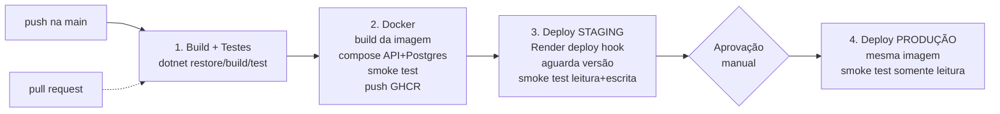
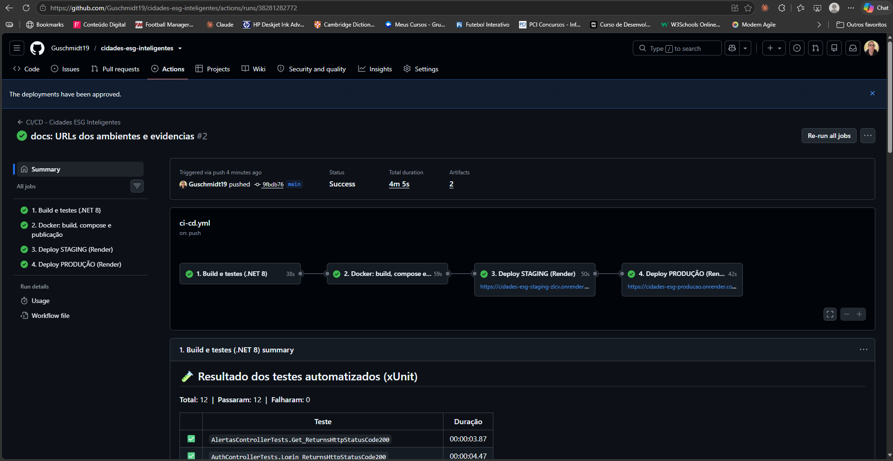
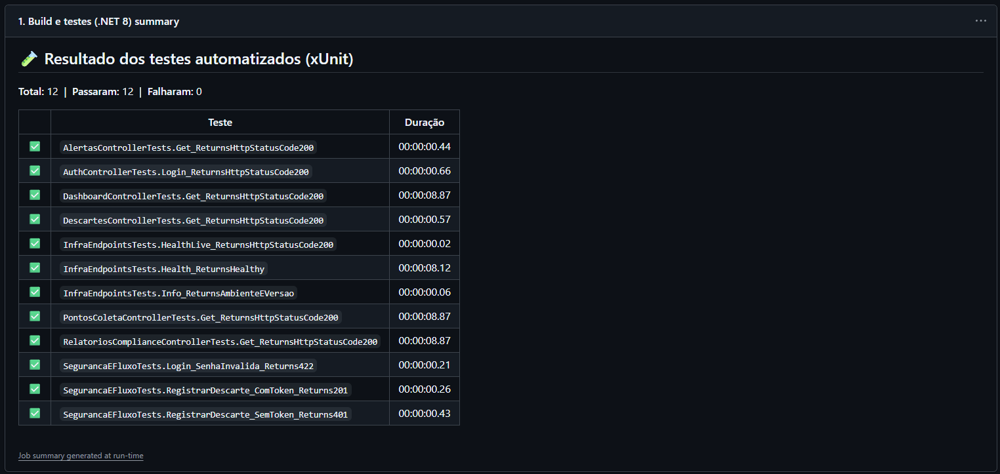
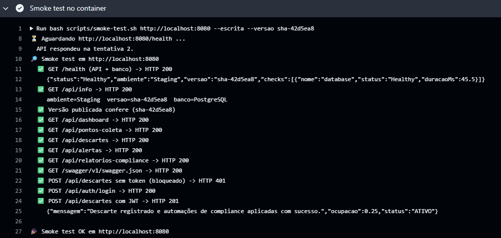
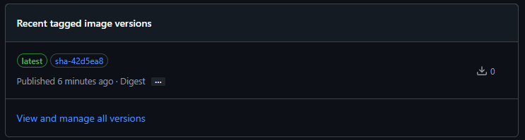
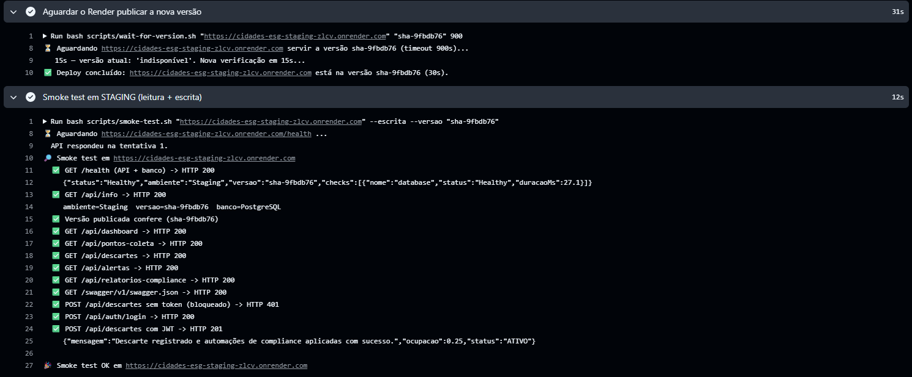
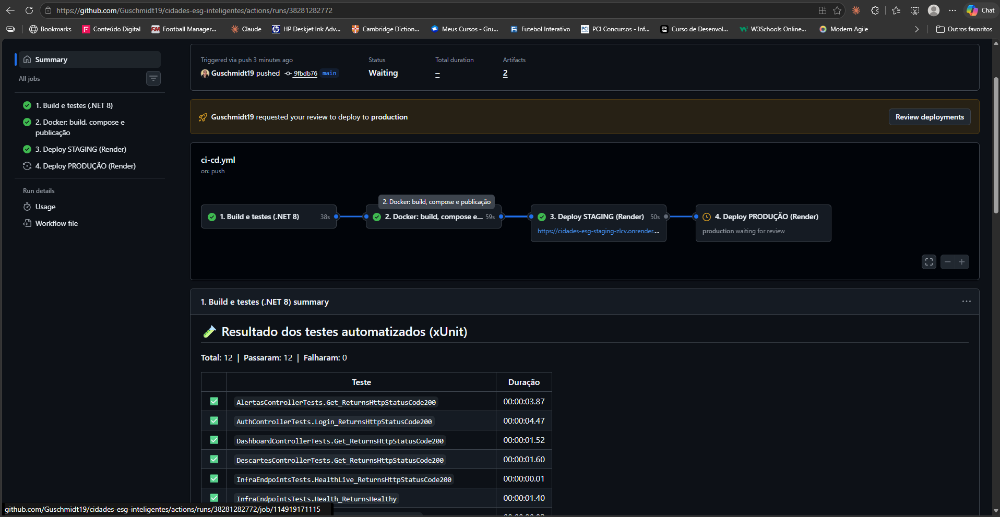
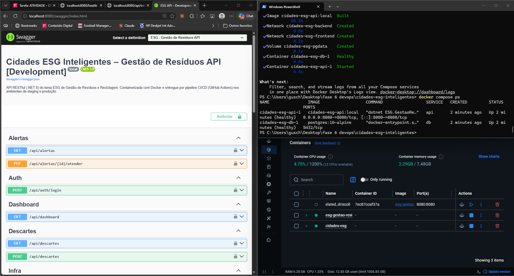
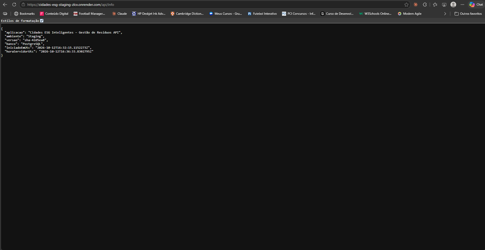
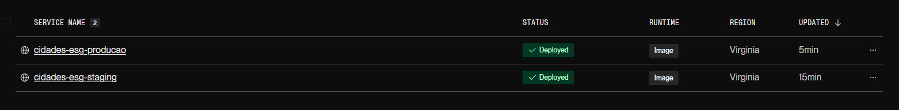

# Projeto - Cidades ESGInteligentes

**API de Gestão de Resíduos e Reciclagem** (.NET 8 / ASP.NET Core) do tema ESG, adaptada para um
ambiente de produção real com **Docker**, **Docker Compose** e um **pipeline CI/CD no GitHub Actions**
que faz build, testes e deploy automatizado nos ambientes de **staging** e **produção** (Render).

> **Aluno:** Gustavo Ferreira Schmidt — RM 562688 · FIAP · Fase "Navegando pelo mundo DevOps"

| Ambiente | URL | Branch / gatilho |
|---|---|---|
| Local (Docker Compose) | http://localhost:8080/swagger | `docker compose up` |
| **Staging** | `https://cidades-esg-staging-zlcv.onrender.com/swagger` | push na `main` → automático |
| **Produção** | `https://cidades-esg-producao.onrender.com/swagger` | após staging aprovado |

---

## Como executar localmente com Docker

### Pré-requisitos
- [Docker Desktop](https://www.docker.com/products/docker-desktop/) (inclui o Docker Compose v2)
- Git

### Passo a passo

```bash
# 1. Clonar o repositório
git clone https://github.com/Guschmidt19/cidades-esg-inteligentes.git
cd cidades-esg-inteligentes

# 2. Criar o arquivo de variáveis de ambiente a partir do modelo
cp .env.example .env            # PowerShell: Copy-Item .env.example .env

# 3. Subir a aplicação (API + PostgreSQL)
docker compose up -d --build

# 4. Acompanhar o status (aguarde "healthy" nos dois serviços)
docker compose ps
docker compose logs -f api
```

Pronto! Acesse:

| O quê | Endereço |
|---|---|
| Swagger (documentação interativa) | http://localhost:8080/swagger |
| Saúde da API + banco | http://localhost:8080/health |
| Ambiente e versão em execução | http://localhost:8080/api/info |
| Adminer (opcional, ver o banco) | `docker compose --profile tools up -d` → http://localhost:8081 |

Na primeira subida a API **cria as tabelas e popula o seed** automaticamente.
Usuários de teste: `admin / Admin@123` e `operador / Operador@123`.

```bash
# Testar tudo de uma vez (Git Bash / Linux / macOS — requer curl e jq)
bash scripts/smoke-test.sh http://localhost:8080 --escrita

# Parar (mantém os dados)       |  Parar e apagar o banco
docker compose down             #  docker compose down -v
```

### Variáveis de ambiente (`.env`)

| Variável | Para que serve | Exemplo |
|---|---|---|
| `ASPNETCORE_ENVIRONMENT` | Ambiente do ASP.NET (`Development`, `Staging`, `Production`) | `Development` |
| `API_PORT` | Porta da API no host | `8080` |
| `APP_VERSION` | Versão exibida em `/api/info` (no CI = SHA do commit) | `local` |
| `POSTGRES_DB` / `POSTGRES_USER` / `POSTGRES_PASSWORD` | Credenciais do banco | `esg_residuos` |
| `JWT_SECRET_KEY` | Chave de assinatura do JWT (≥ 32 caracteres) | — |

Dentro do container, o ASP.NET lê a configuração por variáveis com `__` (ex.: `ConnectionStrings__DefaultConnection`,
`Jwt__SecretKey`, `Database__Provider`), que **sobrescrevem** o `appsettings.json` — assim nenhum segredo de staging/produção fica no código.

### Executar sem Docker (opcional)
Com o .NET SDK 8 e um PostgreSQL local: `dotnet run --project src/ESG.GestaoResiduos.API`.
Para usar o **Oracle da FIAP** (projeto original), defina `Database__Provider=Oracle` e a `ConnectionStrings__OracleConnection`.

---

## Pipeline CI/CD

**Ferramenta:** GitHub Actions — arquivo [`.github/workflows/ci-cd.yml`](.github/workflows/ci-cd.yml).
**Registry de imagens:** GitHub Container Registry (GHCR). **Hospedagem:** Render (um serviço para staging e outro para produção).
**Banco em nuvem:** PostgreSQL gerenciado (Neon), com um banco separado para cada ambiente.



### Etapas

| # | Job | O que faz | Falha quando… |
|---|---|---|---|
| 1 | **Build e testes** | `dotnet restore` → `dotnet build -c Release` → `dotnet test` (xUnit, 12 testes com banco InMemory). Gera resumo na aba *Summary* e o artefato `resultados-testes` (.trx + cobertura). | não compila ou algum teste falha |
| 2 | **Docker** | Constrói a imagem com a tag `sha-<commit>`, sobe **API + PostgreSQL com Docker Compose** dentro do runner e roda o `smoke-test.sh` contra o container. Salva os logs como artefato e publica a imagem no **GHCR** (`:sha-xxxxxxx` e `:latest`). | o container não sobe, o banco não conecta ou algum endpoint responde errado |
| 3 | **Deploy STAGING** | Chama o *deploy hook* do Render informando a imagem exata (`imgURL`), espera `/api/info` mostrar a nova versão e roda o smoke test **com escrita** (login JWT + registro de descarte). | deploy não conclui em 15 min ou smoke test falha |
| 4 | **Deploy PRODUÇÃO** | Só começa se staging passou. Promove **a mesma imagem** (build once, deploy many). O environment `production` pode exigir **aprovação manual**. Smoke test **somente leitura**. | idem |

### Lógica e boas práticas aplicadas
- **Gatilhos:** `push` na `main` executa tudo; `pull_request` executa só build/testes/docker (nada é publicado); `workflow_dispatch` permite rodar manualmente.
- **Build once, deploy many:** a imagem testada no CI é a mesma que vai para staging e produção — muda só a configuração (variáveis de ambiente de cada serviço).
- **Rastreabilidade:** a tag da imagem é o SHA do commit e a API expõe essa versão em `/api/info`, o que permite ao pipeline confirmar que o deploy realmente terminou.
- **Segredos fora do código:** deploy hooks ficam em *GitHub Environments secrets*; connection strings e chave JWT ficam nas variáveis de ambiente do Render.
- **Portões de qualidade:** cada etapa depende da anterior (`needs`); produção depende de staging saudável.
- **Concorrência controlada:** `concurrency` impede dois deploys simultâneos.

### Configuração necessária no GitHub (uma vez)

| Onde | Nome | Valor |
|---|---|---|
| *Settings → Secrets and variables → Actions → Variables* | `STAGING_URL` | URL do serviço de staging no Render |
| idem | `PRODUCTION_URL` | URL do serviço de produção no Render |
| *Settings → Environments → staging → Secrets* | `RENDER_DEPLOY_HOOK_URL` | Deploy hook do serviço de staging |
| *Settings → Environments → production → Secrets* | `RENDER_DEPLOY_HOOK_URL` | Deploy hook do serviço de produção |
| *Settings → Environments → production* | Required reviewers | (opcional) seu usuário, para aprovar o deploy |

O passo a passo completo (GitHub, Neon e Render) está em [`docs/GUIA_DEPLOY.md`](docs/GUIA_DEPLOY.md).

---

## Containerização

### Dockerfile

```dockerfile
# syntax=docker/dockerfile:1
# =============================================================================
#  Dockerfile multi-stage — Cidades ESG Inteligentes · API Gestão de Resíduos
#  (.NET 8 / ASP.NET Core)
#
#  Estágios:
#    build   -> restaura dependências e compila a solução (API + testes)
#    test    -> (opcional) roda os testes:  docker build --target test .
#    publish -> gera os binários otimizados da API
#    final   -> imagem enxuta de runtime, usuário não-root e healthcheck
# =============================================================================

# ---------- Stage 1: build ---------------------------------------------------
FROM mcr.microsoft.com/dotnet/sdk:8.0 AS build
WORKDIR /src

# 1) Copia só os arquivos de projeto e restaura: esta camada fica em cache e
#    só é refeita quando alguma dependência (.csproj) muda.
COPY ESG.GestaoResiduos.sln ./
COPY src/ESG.GestaoResiduos.API/ESG.GestaoResiduos.API.csproj src/ESG.GestaoResiduos.API/
COPY tests/ESG.GestaoResiduos.Tests/ESG.GestaoResiduos.Tests.csproj tests/ESG.GestaoResiduos.Tests/
RUN dotnet restore ESG.GestaoResiduos.sln

# 2) Copia o código-fonte e compila em Release.
COPY src/ src/
COPY tests/ tests/
RUN dotnet build ESG.GestaoResiduos.sln -c Release --no-restore

# ---------- Stage 2: test (opcional) ----------------------------------------
FROM build AS test
RUN dotnet test ESG.GestaoResiduos.sln -c Release --no-build

# ---------- Stage 3: publish -------------------------------------------------
FROM build AS publish
RUN dotnet publish src/ESG.GestaoResiduos.API/ESG.GestaoResiduos.API.csproj \
    -c Release --no-build -o /app/publish /p:UseAppHost=false

# ---------- Stage 4: runtime (imagem final) ----------------------------------
FROM mcr.microsoft.com/dotnet/aspnet:8.0 AS final

# Versão injetada pelo pipeline (ex.: sha-1a2b3c4). Aparece em /api/info.
ARG APP_VERSION=local

LABEL org.opencontainers.image.title="cidades-esg-inteligentes-api" \
      org.opencontainers.image.description="API ESG de Gestão de Resíduos e Reciclagem (.NET 8)" \
      org.opencontainers.image.version="${APP_VERSION}" \
      org.opencontainers.image.authors="Gustavo Ferreira Schmidt - RM 562688"

# curl é usado apenas pelo HEALTHCHECK do container.
RUN apt-get update \
    && apt-get install -y --no-install-recommends curl \
    && rm -rf /var/lib/apt/lists/*

WORKDIR /app
COPY --from=publish --chown=app:app /app/publish .

ENV ASPNETCORE_HTTP_PORTS=8080 \
    ASPNETCORE_ENVIRONMENT=Production \
    APP_VERSION=${APP_VERSION}

EXPOSE 8080

# Segurança: a aplicação roda com o usuário sem privilégios "app"
# (já existe nas imagens oficiais do .NET 8).
USER app

# O Docker marca o container como "healthy" só quando a API responde.
HEALTHCHECK --interval=30s --timeout=5s --start-period=40s --retries=3 \
    CMD curl -fsS "http://localhost:${PORT:-8080}/health/live" || exit 1

ENTRYPOINT ["dotnet", "ESG.GestaoResiduos.API.dll"]
```

### Estratégias adotadas
- **Multi-stage build:** o SDK (~800 MB) só existe nos estágios de build; a imagem final usa apenas o runtime `aspnet:8.0`, ficando bem menor.
- **Cache de camadas:** os `.csproj` são copiados e restaurados antes do código-fonte — mudar código não refaz o `dotnet restore`.
- **Estágio de testes opcional:** `docker build --target test .` executa os testes dentro do Docker.
- **Segurança:** a aplicação roda com o usuário **não-root** `app`; nenhum segredo é copiado para a imagem (`.dockerignore` exclui `.env`).
- **Healthcheck:** o Docker consulta `/health/live`; a rota `/health` também verifica a conexão com o banco.
- **Configuração por ambiente:** porta (`PORT`/`ASPNETCORE_HTTP_PORTS`), ambiente, banco e JWT vêm de variáveis — a mesma imagem roda local, em staging e em produção.
- **Rastreabilidade:** `APP_VERSION` e *labels* OCI identificam o commit de origem da imagem.

### Orquestração — `docker-compose.yml`

| Serviço | Imagem | Função |
|---|---|---|
| `db` | `postgres:16-alpine` | Banco de dados; healthcheck com `pg_isready`; **sem porta publicada** |
| `api` | build do `Dockerfile` | API .NET 8; só inicia quando o banco está `healthy` (`depends_on: condition: service_healthy`) |
| `adminer` | `adminer:4.8.1` | (perfil `tools`) interface web para consultar o banco |

- **Volume:** `cidades-esg-pgdata` → persiste os dados do PostgreSQL entre reinícios.
- **Redes:** `backend` (API ↔ banco, resolução por nome `db`) e `frontend` (portas publicadas).
- **Variáveis de ambiente:** lidas do `.env` (modelo em `.env.example`); variáveis obrigatórias usam `${VAR:?mensagem}` e impedem subir sem configuração.
- **Resiliência:** `restart: unless-stopped` e retentativa de conexão com o banco no startup da API.

```bash
docker build -t cidades-esg-api:local .                 # construir só a imagem
docker build --target test .                             # rodar os testes no Docker
docker compose up -d --build                             # subir API + banco
docker compose ps                                        # status/healthcheck
docker compose logs -f api                               # logs da API
docker compose down -v                                   # derrubar e limpar volume
```

---

## Prints do funcionamento

> As imagens ficam em [`docs/prints/`](docs/prints/).

### Pipeline (GitHub Actions)
| Evidência | Print |
|---|---|
| Execução completa do pipeline (4 jobs verdes) |  |
| Job 1 — build e testes (resumo dos testes) |  |
| Job 2 — Docker Compose + smoke test no container |  |
| Imagem publicada no GHCR |  |
| Job 3 — deploy em staging |  |
| Aprovação + Job 4 — deploy em produção |  |

### Ambientes funcionando
| Evidência | Print |
|---|---|
| Docker local — `docker compose ps` (healthy) |  |
| Staging — Swagger / `/api/info` |  |
| Produção — Swagger / `/api/info` |  |
| Render — serviços de staging e produção |  |

---

## Tecnologias utilizadas

| Categoria | Tecnologias |
|---|---|
| Linguagem / framework | C# 12, **.NET 8**, ASP.NET Core Web API |
| Persistência | Entity Framework Core 8, **PostgreSQL 16** (Npgsql), Oracle (opcional, projeto original) |
| Segurança | JWT Bearer, BCrypt |
| Documentação da API | Swagger / Swashbuckle |
| Testes | xUnit, `WebApplicationFactory`, EF Core InMemory, Coverlet |
| Containerização | **Docker** (multi-stage), **Docker Compose** |
| CI/CD | **GitHub Actions**, GitHub Environments, GitHub Container Registry (GHCR) |
| Cloud | **Render** (staging e produção), **Neon** (PostgreSQL gerenciado) |
| Scripts | Bash (smoke test / wait-for-version), Python (resumo dos testes) |

---

## Sobre a API (domínio ESG)

Mais de quatro endpoints RESTful focados no problema real (sem CRUD de usuário).

| # | Método | Rota | Auth | Descrição |
|---|--------|------|------|-----------|
| 1 | POST | `/api/auth/login` | Pública | Autentica e devolve token JWT. |
| 2 | **POST** | `/api/descartes` | **JWT** | **Endpoint crítico.** Registra descarte e dispara as 4 automações. |
| 3 | GET | `/api/descartes` | Pública | Lista descartes **paginada** (filtro por ponto). |
| 4 | GET | `/api/pontos-coleta` | Pública | Lista pontos **paginada** com filtros (status, tipo, busca, ocupação mínima). |
| 5 | GET | `/api/pontos-coleta/{id}` | Pública | Detalhe de um ponto + ocupação. |
| 6 | GET | `/api/alertas` | Pública | Lista alertas **paginada** (status, ponto). |
| 7 | **PUT** | `/api/alertas/{id}/atender` | **JWT** | **Endpoint crítico.** Registra coleta, libera o ponto e atende o alerta. |
| 8 | GET | `/api/relatorios-compliance` | Pública | Lista relatórios **paginada** (ano, mês, ponto, conformidade). |
| 9 | GET | `/api/relatorios-compliance/consolidado` | Pública | Agregação por período (GROUP BY no banco). |
| 10 | GET | `/api/dashboard` | Pública | Indicadores ESG consolidados. |

#### Regras de negócio do registro de descarte (POST /api/descartes)
Reproduzem, dentro de uma **transação**, os triggers PL/SQL originais:
1. **TRG_ATUALIZA_PONTO_COLETA** → soma o peso à quantidade acumulada do ponto.
2. **TRG_ALERTA_CAPACIDADE** → gera alerta ao atingir 80% (sem duplicar alerta pendente).
3. **TRG_STATUS_PONTO_CHEIO** → marca o ponto como `CHEIO` ao atingir a capacidade.
4. **TRG_RELATORIO_COMPLIANCE** → cria/atualiza o relatório de compliance do mês/ano.


Novos endpoints de infraestrutura (DevOps): `GET /health`, `GET /health/live` e `GET /api/info`.

### Estrutura do projeto

```
cidades-esg-inteligentes/
├── .github/workflows/ci-cd.yml   # pipeline CI/CD
├── Dockerfile                    # imagem multi-stage
├── docker-compose.yml            # API + PostgreSQL (+ Adminer)
├── .env.example                  # modelo das variáveis de ambiente
├── src/ESG.GestaoResiduos.API/   # código-fonte da API (.NET 8)
├── tests/ESG.GestaoResiduos.Tests/  # testes xUnit
├── scripts/                      # smoke test, espera de deploy, resumo de testes, SQL Oracle
├── insomnia/                     # coleção de requisições
├── docs/                         # guia de deploy, prints e documentação (PDF)
└── README.md
```

---

## Checklist de entrega

| Item | OK |
|---|---|
| Projeto compactado em .ZIP com estrutura organizada | ☐ |
| Dockerfile funcional | ☐ |
| docker-compose.yml ou arquivos Kubernetes | ☐ |
| Pipeline com etapas de build, teste e deploy | ☐ |
| README.md com instruções e prints | ☐ |
| Documentação técnica com evidências (PDF ou PPT) | ☐ |
| Deploy realizado nos ambientes staging e produção | ☐ |
